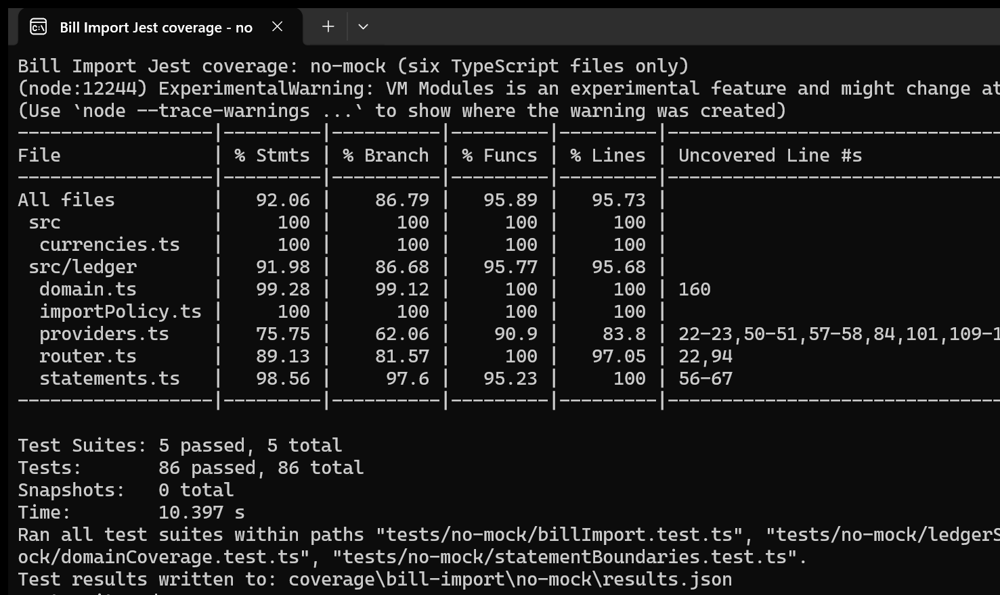
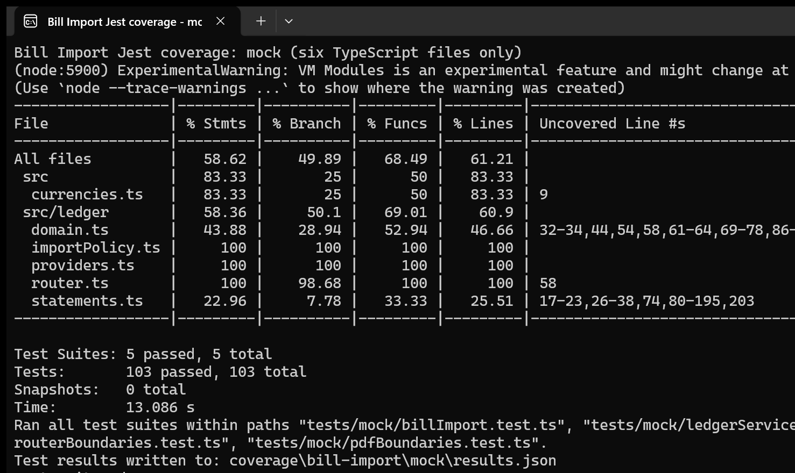
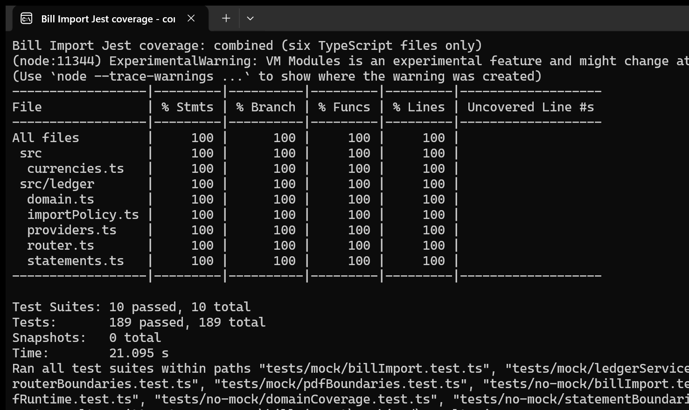

# Testing

## Change History

| Date | Description |
| --- | --- |
| 11/02/2026 | Creation of this file. Reporting E2E testing results for Feature 1 and backend testing results for Bill Import component. |


## Locations of Backend Tests

| Interfaces | Describe group without mocks | Describe group with mocks | Components mocked |
| --- | --- | --- | --- |
| `GET /api/ledger/meta` | [billImport.test.ts:5](../backend/tests/no-mock/billImport.test.ts#L5) | [billImport.test.ts:12](../backend/tests/mock/billImport.test.ts#L12) | FX provider `quote` and document extractor `extract`. |
| `GET /api/ledger/exchange` | [billImport.test.ts:20](../backend/tests/no-mock/billImport.test.ts#L20) | [billImport.test.ts:29](../backend/tests/mock/billImport.test.ts#L29) | Frankfurter HTTP `fetch` for upstream responses/errors; FX provider `quote` and `Date.now` for rate-limit window recovery. |
| `POST /api/ledger/imports/preview` | [billImport.test.ts:61](../backend/tests/no-mock/billImport.test.ts#L61); [ledgerServices.test.ts:96 — authenticated requests and live recognition](../backend/tests/no-mock/ledgerServices.test.ts#L96) | [billImport.test.ts:76](../backend/tests/mock/billImport.test.ts#L76) | OpenAI HTTP `fetch` for recognition responses/errors; document extractor `extract` for upload validation and file-signature checks. |
| `POST /api/ledger/imports/statement-preview` | [billImport.test.ts:76](../backend/tests/no-mock/billImport.test.ts#L76) | [billImport.test.ts:131](../backend/tests/mock/billImport.test.ts#L131) | Local statement extractor `localExtractor.extract` and AI extractor `extractor.extract` for shared concurrency limits, capacity recovery, rate limits, and absence of implicit AI calls. |

## Location of .yml files

[.github/workflows/backend-tests.yml](../.github/workflows/backend-tests.yml)

## Front-end test suite location

Suite: [frontend/app/src/androidTest/java/com/example/cpen321application/e2e/](../frontend/app/src/androidTest/java/com/example/cpen321application/e2e/).

Use-case steps below refer to the formal specifications in Requirements_and_Design.md:
- UC-01: receipt recognition;
- UC-02: duplicate review/commit;
- UC-F1-03: statement import;
- UC-F1-04: manual entry;
- UC-F1-05: review/edit/delete;
- UC-F1-06: currency conversion;
- UC-F1-07: cloud saves.

Execution logs see Gradle log (res/testing/cp2/android-e2e.txt) and per-test JUnit results(res/testing/cp2/android-e2e.xml) on GitHub.

**Feature1E2eTest.kt — 9 tests**

| Test name | Formal use-case steps → test steps and expected behavior | Recorded status |
| --- | --- | --- |
| invalidManualEntryDoesNotPersistAndDeleteCanBeCancelled | **UC-F1-04 1–2, 2a:** Add → Save with no amount; “Check transaction” appears and record IDs are unchanged.<br>**UC-F1-04 2–4:** Enter 8 and a merchant → Save; “Transaction added” appears and one record exists.<br>**UC-F1-05 2a:** Edit amount to `invalid` → Save; validation appears and the saved record is unchanged.<br>**UC-F1-05 3a:** Delete → Keep transaction; the record remains. | PASS |
| csvSystemPickerCorrectInvalidRowSkipDuplicateAndCommitOnce | **UC-F1-03 1–3:** Pick a CSV through DocumentsUI → Preview CSV; review appears and confirmation is disabled.<br>**UC-02 1–3; UC-F1-03 4:** See the duplicate warning → deselect that row → change the invalid amount to 12; confirmation enables and no preview row has been saved.<br>**UC-02 4–8:** Confirm one row; “1 transaction imported,” one CSV record, and a total of 19 are verified.<br>**UC-F1-05 1, 4:** Recreate the activity → search the merchant; saved IDs persist and the filtered expense total is −19. | PASS |
| cancelPickerAndDiscardReviewLeaveLedgerUnchanged | **UC-F1-03 1a:** Open the system picker → Back; Import shows “Choose a file.”<br>**UC-F1-03 1–3:** Pick a CSV → Preview CSV; review appears.<br>**UC-F1-03 3a:** Start a different import → Keep reviewing; the review remains. Repeat → Discard review; file selection returns and the complete ledger equals its initial state. | PASS |
| csvSystemPickerKeepsDuplicateOnlyAfterExplicitAcknowledgement | **UC-F1-03 1–3; UC-02 1–2:** Pick/preview a CSV matching an existing entry; a duplicate warning appears, confirmation is disabled, and only the original record exists.<br>**UC-02 3, 3a:** Choose “Keep transaction 1 despite possible duplicates”; confirmation enables.<br>**UC-02 4–8:** Confirm; one CSV row is imported, both purchases remain, and their amounts total 14. | PASS |
| unsupportedPdfFailsWithoutSavingThenRealChasePdfImportsViaBackend | **UC-F1-03 1, 2b:** Pick an unsupported PDF → Preview statement; the supported-bank error appears and no fixture record is saved.<br>**UC-F1-03 1–3:** Replace it with a real Chase PDF → Preview statement through the backend; review appears before any save.<br>**UC-F1-03 4; UC-02 4–8:** Confirm; one USD 10.00 record dated 2025-01-03 retains its source filename. If conversion is needed, the saved FX source is Frankfurter/ECB with a positive converted amount. | PASS |
| explicitAiReceiptPreviewAndCommitUseRealBackend | **UC-01 1–2:** With a session, pick the synthetic receipt PDF → Send to OpenAI & extract.<br>**UC-01 3–8:** Wait for the real backend/OpenAI review; no fixture record is saved before confirmation. This case uses a valid PDF and requires no field correction.<br>**UC-02 4–8:** Confirm the single candidate; verify amount 10, original currency, date 2025-01-03, and source filename. | PASS |
| cloudSaveRenameCancelLoadRestoreAndDeleteUseRealAccountBackend | **UC-F1-07 1:** Me → Cloud saves; a free slot is available.<br>**2, 2a:** Empty name disables Save; enter a name → Cancel leaves the slot empty; repeat → Save persists its name on the backend.<br>**3:** Rename → Save; the backend name changes.<br>**3a:** Another API client changes the revision while the editor is open; submit the stale rename → conflict message and refreshed remote name, without overwriting it.<br>**4, 4a:** After removing the local fixture, cancel Load → it stays absent; confirm Load → it is restored.<br>**5, 5a:** Cancel Delete → server slot remains; confirm Delete → server slot is absent. | PASS |
| reportingCurrencyUsesHistoricalFxAndUiFiltersSelectOnlyExpenses | **UC-F1-06 1–4:** With USD expense/income fixtures, choose CAD; reporting currency becomes CAD, USD 10 remains the original amount, its converted value is CAD 14.41, and the effective rate date is Friday 2025-01-03.<br>**UC-F1-05 1, 3:** Search the merchant → Expenses → Select all shown; only one expense is selected.<br>**UC-F1-05 3a:** Cancel deletion; both records remain.<br>**UC-F1-05 3–4:** Confirm deletion; “1 transactions deleted” appears and only the income remains. | PASS |
| malformedCsvAndEmptyFileAreRejectedWithoutSaving | **UC-F1-03 1, 2a:** Pick a CSV with unrelated headers → Preview CSV; the required-columns error appears and no fixture record is saved.<br>**UC-F1-03 1b:** Remove it → pick an empty CSV; “This file is empty” appears and no fixture record is saved. | PASS |

**LedgerUiTest.kt — 7 reused tests**

| Test location | Formal use-case steps → test steps and expected behavior | Recorded status |
| --- | --- | --- |
| myExpensesIsHomeAndTabsCanBeReopened | **UC-F1-04 precondition; UC-F1-05 1:** Verify My Expenses is selected → open Me → Back → open Groups → Expenses; My Expenses/dashboard is available again. | PASS |
| expensesTabReturnsToDashboardAndReselectionResetsEditor | **UC-F1-04 1; UC-F1-05 1:** Add → enter 42 → Me → Expenses; the dashboard returns. Open Add again → reselect Expenses; the dashboard returns again. | PASS |
| createEditAndDeleteTransactionThroughTheUi | **UC-F1-04 1–3:** Enter amount/merchant → Save; the success notice appears and SQLite contains 1234 minor units.<br>**UC-F1-05 2:** Open the row → change amount → Save; SQLite contains 2345 minor units and revision 2.<br>**UC-F1-05 3–4:** Open Delete → confirm; the deletion notice appears and the record is absent. | PASS |
| draftSurvivesActivityRecreationWithoutSaving | **UC-F1-04 1, 1a:** Enter amount 42 and merchant → recreate the activity; both draft fields survive and no record is saved.<br>**UC-F1-04 1a:** Back → “Discard your changes?” → Discard; the dashboard returns. | PASS |
| csvContentUriRequiresDuplicateReviewBeforeAtomicImport | **UC-F1-03 1 (partial):** Supply a FileProvider URI through `chooseDocument`; this bypasses the system picker.<br>**UC-F1-03 2–3; UC-02 1–2:** Preview CSV; two review rows appear and duplicate confirmation is disabled.<br>**UC-02 3–8:** Acknowledge the duplicate → Confirm; two CSV records are saved, including the explicitly retained duplicate.<br>**UC-F1-06 1 (menu only):** Open the currency menu; the current-currency checkmark appears. | PASS |
| newViewModelShowsHistoricPdfAndReceiptImportsWithoutReimporting | **UC-F1-05 1, 4:** Seed historical PDF/receipt records through the repository → create a fresh ViewModel; its month filter is unset and both saved IDs are visible. This checks reload state, not document extraction or a full process restart. | PASS |
| bulkDeleteCanCancelAndDeletesOnlyFilteredSelectedRecords | **UC-F1-05 1:** Seed two expenses/one income and set search/kind through the ViewModel; two expenses are visible.<br>**UC-F1-05 3, 3a:** Select all shown → Delete → Cancel; all three records remain.<br>**UC-F1-05 3b:** Change the kind filter through the ViewModel; selection clears and selection mode ends.<br>**UC-F1-05 3–4:** Filter expenses again → Select all shown → confirm deletion; only the income remains. | PASS |

## NFR location
To be done within CP3. Not covered yet.

## Jest Coverage

Scope: `currencies.ts`, `domain.ts`, `importPolicy.ts`, `providers.ts`, `router.ts`, and `statements.ts`.

**Without mocks:**



**With mocks:**



**Combined:**




## How to run Tests

Commit hash: `c7f846ad5694316405565dc4ca3bded281079416`.

**Test running prerequisites:**
 - Frondend: Install JDK 17 and the Android SDK required by `frontend/`, then start one Android emulator. Preserve `sdk.dir` and set `API_BASE_URL` in `frontend/local.properties` to a running backend with MongoDB and OpenAI recognition configured; use `http://10.0.2.2:3000` for a backend running locally on port 3000. Start a local backend with `npm run dev` from `backend/` in a separate terminal after configuring `backend/.env`.
 - Use Node.js 22.13+ within 22.x and npm 10+. Set a valid `OPENAI_API_KEY` in `backend/.env`. Internet access is required. Commands below were used on PowerShell.

**E2E for Feature 1:**

```powershell
cd frontend
.\gradlew.bat :app:connectedDebugAndroidTest `
  '-Pandroid.testInstrumentationRunnerArguments.class=com.example.cpen321application.e2e.Feature1E2eTest,com.example.cpen321application.e2e.LedgerUiTest' `
  '-Pandroid.testInstrumentationRunnerArguments.ledgerLiveAi=true' `
  '-Pandroid.testInstrumentationRunnerArguments.ledgerProvisionAccount=true' --console=plain
cd ..
```

This runs the two Feature 1 E2E classes. `ledgerLiveAi` enables receipt recognition; `ledgerProvisionAccount` creates temporary test accounts for the authenticated Feature 1 scenarios. Open `frontend/app/build/reports/androidTests/connected/debug/index.html` for results.

**Bill Import backend (from the repository root):**

```powershell
cd backend
npm ci
cd ..
./scripts/test-bill-import.ps1 -Mode no-mock
./scripts/test-bill-import.ps1 -Mode mock
./scripts/test-bill-import.ps1 -Mode combined
```

The script prints Jest coverage and saves JSON results to `backend/coverage/bill-import/<mode>/`. The combined run requires 100% statements, branches, functions and lines.
